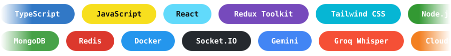

<!-- Animated banner (twinkling stars) -->

<!-- Typing animation -->

 

<!-- Links -->

 

##  About Me

<table>
<tr>
<td width="60%" valign="top">

> **Self-taught. Solo. Shipping.**

I'm a Full-Stack Developer who is currently the **sole developer of a production SaaS ERP** at KT Computech, and independently building an **AI-powered interview platform** on a microservices architecture.

I own the full stack: schema design, API architecture, real-time systems, deployment, and the UI. **No handoffs.**

</td>
<td width="40%" valign="top">

**Quick facts**

📍 Durgapur, West Bengal, India  
💼 Full-Stack Developer @ KT Computech  
🎓 BCA · ABS Academy · 2025  
🏅 Swami Vivekananda Scholarship  
🌐 [suvam.info](https://suvam.info)

</td>
</tr>
</table>

##  Currently in Production

<table>
<tr>
<td width="50%" valign="top">

### 🏭 ERP & Retail Platform
**KT Computech · Aug 2025 – Present**

A multi-portal SaaS system for inventory, billing, accounting, and delivery, built solo from scratch.

- 📦 **1,500+ live orders** processed
- 🔐 Admin, customer & delivery-agent portals with **JWT + RBAC**
- ⚡ Real-time order tracking via **Socket.IO**
- 🧾 PDF/Excel reports, barcode scanning, receipt printing
- 🛡️ Redis rate limiting, Helmet, XSS & NoSQL injection guards
- ☁️ Deployed on Render + Netlify + Cloudflare Tunnel

</td>
<td width="50%" valign="top">

### 🤖 AI Interview Platform
**Personal · Dockerized microservices**

A six-service platform for AI-driven technical interviews.

- 🧠 **Gemini** for question generation and structured feedback
- 🎙️ **Groq Whisper** for live speech transcription
- 🔌 Real-time interview sessions via **Socket.IO**
- 🚨 Anti-cheat: tab-switch, fullscreen, clipboard & DevTools detection
- 📊 Organization analytics with candidate-level score breakdowns
- 🐳 Containerized with **Docker**

</td>
</tr>
</table>

##  Tech Stack

##  GitHub Stats

<!-- Contribution snake (generated by .github/workflows/snake.yml) -->
<picture>
  <source media="(prefers-color-scheme: dark)" srcset="https://raw.githubusercontent.com/Sc-Designs/Sc-Designs/output/github-contribution-grid-snake-dark.svg" />
  <source media="(prefers-color-scheme: light)" srcset="https://raw.githubusercontent.com/Sc-Designs/Sc-Designs/output/github-contribution-grid-snake.svg" />
  
</picture>

##  Background

| | |
|---|---|
| **Education** | BCA · ABS Academy, Durgapur · 2025 · CGPA 7.79 |
| **Scholarship** | Swami Vivekananda Scholarship recipient |
| **Certifications** | Cyber Security & Ethical Hacking (ISOEH) · Front-End Domination (Sheryians) · Job-Ready Hackathon (Sheryians) |

##  Let's Connect

Got a project, an idea, or just want to talk code? Reach out.

  

